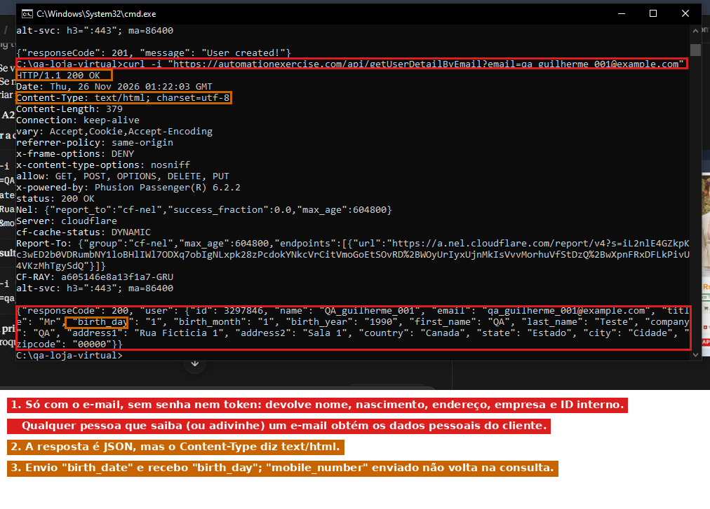

# OBS-001: API devolve dados pessoais sem autenticação

| Campo | Valor |
|---|---|
| Tipo | Bug |
| Frente | API de conta |
| Severidade | Crítica |
| Teste automatizado | `cypress/e2e/api-conta/seguranca-dados.cy.js` (falha esperada) |

## Passos para reproduzir
1. Criar uma conta pela API (`createAccount`) com dados fictícios.
2. Sem login, senha ou token, chamar `GET /api/getUserDetailByEmail?email=<e-mail da conta>`.

## Resultado esperado
A API recusa a consulta (401/403) ou exige autenticação do próprio titular. Premissa PR04: dado pessoal só com autenticação (LGPD).

## Resultado obtido
HTTP 200 com nome, data de nascimento, endereço completo, empresa e ID interno do cliente. Basta saber ou adivinhar o e-mail.

## Impacto para o negócio
Exposição de dados pessoais de qualquer cliente. Para o CPB, risco legal (LGPD) e de imagem. Bloqueia o aceite da entrega.

## Sugestão de correção
Exigir autenticação (token de sessão) e permitir a consulta só do próprio titular ou de perfil administrativo. Registrar acessos.

## Evidência

