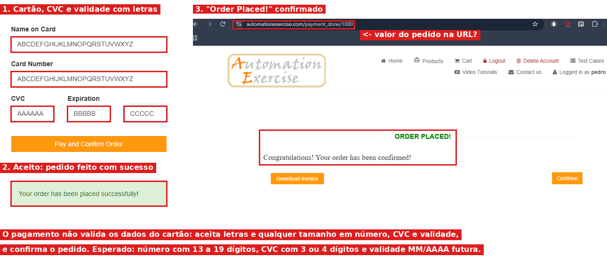

# OBS-002: Pagamento aceita dados de cartão inválidos e confirma o pedido

| Campo | Valor |
|---|---|
| Tipo | Bug |
| Frente | Compra |
| Severidade | Crítica |
| Teste automatizado | `cypress/e2e/compra/pagamento-invalido.cy.js` (falha esperada, 4 casos data-driven) |

## Passos para reproduzir
1. Entrar com uma conta e adicionar um produto ao carrinho.
2. Proceed To Checkout > Place Order.
3. Preencher número do cartão, CVC e validade com letras (ex.: `ABCDEF`).
4. Clicar em Pay and Confirm Order.

## Resultado esperado
O pedido não é confirmado e cada campo inválido é apontado. Premissa PR05: número com 13 a 19 dígitos, CVC com 3 ou 4 dígitos, validade MM/AAAA futura.

## Resultado obtido
Mensagem "Your order has been placed successfully!" e tela "Order Placed!".

## Impacto para o negócio
Pedidos confirmados sem pagamento válido: perda financeira e retrabalho na conferência.

## Sugestão de correção
Validar formato na tela e no servidor, e confirmar o pedido só após a aprovação do meio de pagamento.

## Evidência

