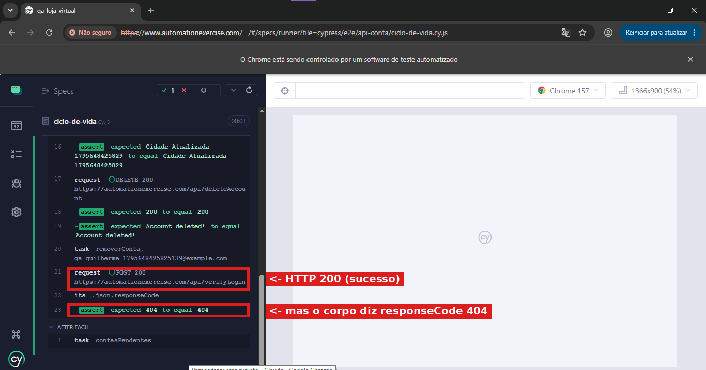
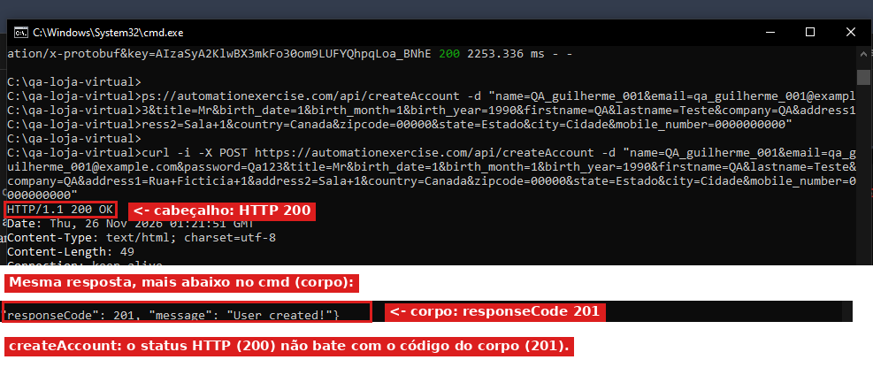

# OBS-003: Status HTTP sempre 200, mesmo em erro

| Campo | Valor |
|---|---|
| Tipo | Bug |
| Frente | API de conta |
| Severidade | Média |
| Teste automatizado | `cypress/e2e/api-conta/contrato-status.cy.js` (falha esperada, 7 casos data-driven) |

## Passos para reproduzir
1. Chamar `POST /api/verifyLogin` com credenciais inexistentes.
2. Chamar `POST /api/createAccount` com dados válidos.
3. Comparar o status HTTP com o `responseCode` do corpo.

## Resultado esperado
O status HTTP reflete o resultado: 404 para não encontrado, 201 para criado, 400 para requisição inválida, 405 para método não suportado (premissa PR03, convenção REST).

## Resultado obtido
HTTP 200 em todos os casos. O resultado real fica só no corpo (`responseCode` 404, 201, 400, 405).

## Impacto para o negócio
Quem integrar e confiar no status HTTP trata erro como sucesso. Monitoramento e alertas por status não funcionam.

## Sugestão de correção
Devolver o status HTTP correspondente ao resultado e manter o `responseCode` no corpo apenas por compatibilidade.

## Evidência

