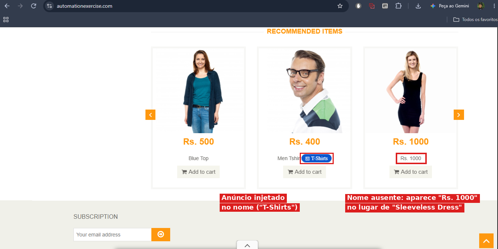

# OBS-004: "Recommended Items" mostra produto sem nome ("Rs. 1000")

| Campo | Valor |
|---|---|
| Tipo | Bug |
| Frente | Catálogo |
| Severidade | Média |
| Teste automatizado | `cypress/e2e/catalogo/catalogo-tela-x-api.cy.js` (falha esperada) |

## Passos para reproduzir
1. Abrir a página inicial.
2. Rolar até "Recommended Items" e avançar o carrossel até o Sleeveless Dress.

## Resultado esperado
O card mostra o mesmo nome da API e da lista principal: "Sleeveless Dress".

## Resultado obtido
O card mostra "Rs. 1000" no lugar do nome. Confirmado no HTML enviado pelo servidor (não é efeito de anúncio).

## Impacto para o negócio
Tela e API contam histórias diferentes. O cliente não sabe qual é o produto.

## Sugestão de correção
Corrigir o template do carrossel para usar o campo de nome do produto.

## Evidência

Trecho do HTML enviado pelo servidor (`view-source:https://automationexercise.com/`), sem anúncios e sem JavaScript.

Recommended Items, produto 3:
```html

<h2>Rs. 1000</h2>
<p>Rs. 1000</p>
<a data-product-id="3" class="btn btn-default add-to-cart">
```

Lista principal (Features Items), mesmo produto 3:
```html

<h2>Rs. 1000</h2>
<p>Sleeveless Dress</p>
<a data-product-id="3" class="btn btn-default add-to-cart">
```


