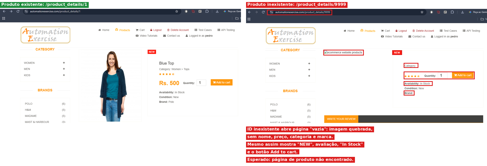

# OBS-005: Produto inexistente é exibido como "In Stock" e com Add to cart

| Campo | Valor |
|---|---|
| Tipo | Bug |
| Frente | Catálogo |
| Severidade | Média |
| Teste automatizado | `cypress/e2e/catalogo/catalogo-tela-x-api.cy.js` (falha esperada) |

## Passos para reproduzir
1. Abrir `/product_details/9999` (ID que não existe na API).

## Resultado esperado
Página "produto não encontrado" (ou HTTP 404), sem botão de compra.

## Resultado obtido
Página vazia, com imagem quebrada, sem nome, preço, categoria e marca, mas com "NEW", avaliação, "In Stock" e Add to cart.

## Impacto para o negócio
Links antigos ou digitados levam a uma página quebrada que parece vender algo. Risco de item inválido no carrinho.

## Sugestão de correção
Responder 404 com página amigável quando o ID não existir.

## Evidência

