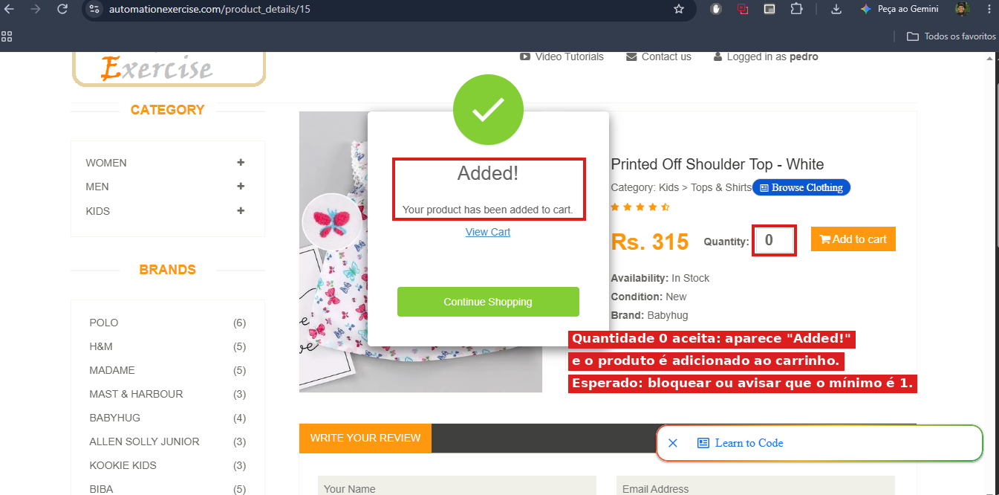

# OBS-006: Carrinho aceita quantidade 0

| Campo | Valor |
|---|---|
| Tipo | Bug |
| Frente | Carrinho |
| Severidade | Alta |
| Teste automatizado | `cypress/e2e/carrinho/quantidade.cy.js` (2 testes de falha esperada: aviso e carrinho) |

## Passos para reproduzir
1. Abrir a página de um produto.
2. Digitar `0` em Quantity e clicar em Add to cart.
3. Abrir o carrinho.

## Resultado esperado
Bloquear a adição ou avisar que a quantidade mínima é 1 (premissa PR02).

## Resultado obtido
Mensagem "Added!" e o produto aparece no carrinho. Confirmado pela automação: a linha do produto continua no carrinho após a adição com quantidade 0.

## Impacto para o negócio
Itens com quantidade 0 no carrinho e no pedido: totais incoerentes e retrabalho.

## Sugestão de correção
Validar quantidade mínima 1 na tela e no servidor.

## Evidência

