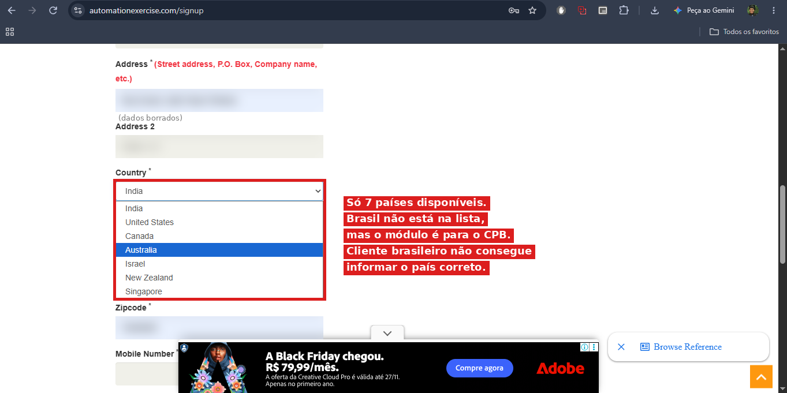

# OBS-007: Cadastro não oferece o Brasil como país

| Campo | Valor |
|---|---|
| Tipo | Regra que falta |
| Frente | Compra |
| Severidade | Alta |
| Teste automatizado | Manual |

## Passos para reproduzir
1. Abrir Signup / Login > New User Signup.
2. Ver as opções do campo Country.

## Resultado esperado
O Brasil disponível (o módulo é para o CPB), com CEP e estados brasileiros.

## Resultado obtido
Só 7 países: India, United States, Canada, Australia, Israel, New Zealand e Singapore.

## Impacto para o negócio
Cliente brasileiro informa país errado: endereço de entrega e cobrança incorretos.

## Sugestão de correção
Incluir o Brasil (e definir a lista de países com o PO, pergunta P06), com validação de CEP de 8 dígitos.

## Evidência

