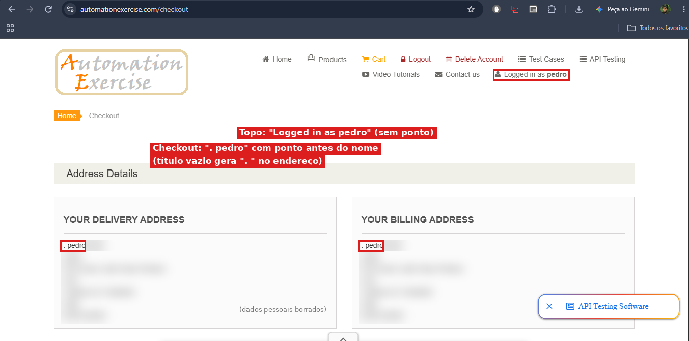

# OBS-008: Nome aparece com ". " na frente no endereço do checkout

| Campo | Valor |
|---|---|
| Tipo | Bug |
| Frente | Compra |
| Severidade | Média |
| Teste automatizado | Manual (causa provável a confirmar: título vazio) |

## Passos para reproduzir
1. Criar conta pela tela sem escolher o título (Mr/Mrs).
2. Entrar, adicionar um produto e abrir o checkout.

## Resultado esperado
Nome exibido sem prefixo quando não houver título.

## Resultado obtido
O endereço de entrega e de cobrança mostra ". <nome>", enquanto o topo mostra "<nome>".

## Impacto para o negócio
Nome errado no endereço de entrega e na cobrança.

## Sugestão de correção
Montar o nome sem o título (e sem o ponto) quando o título estiver vazio, ou tornar o título obrigatório.

## Evidência

