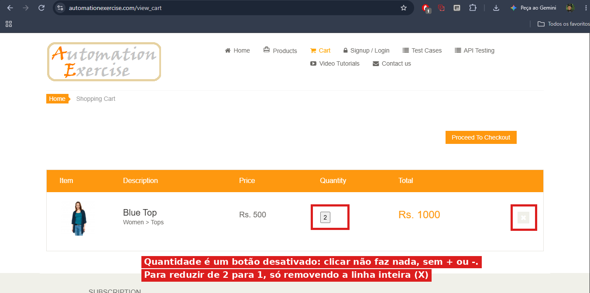

# OBS-009: Quantidade não pode ser alterada dentro do carrinho

| Campo | Valor |
|---|---|
| Tipo | Regra que falta |
| Frente | Carrinho |
| Severidade | Média |
| Teste automatizado | Manual |

## Passos para reproduzir
1. Adicionar um produto 2 vezes.
2. Abrir o carrinho e tentar mudar a quantidade.

## Resultado esperado
Permitir aumentar ou diminuir a quantidade no carrinho (pergunta P02).

## Resultado obtido
A quantidade é um botão desativado. Para reduzir, só removendo a linha inteira e adicionando de novo.

## Impacto para o negócio
Atrito na compra e risco de desistência.

## Sugestão de correção
Trocar o botão por um seletor de quantidade com atualização do total.

## Evidência

