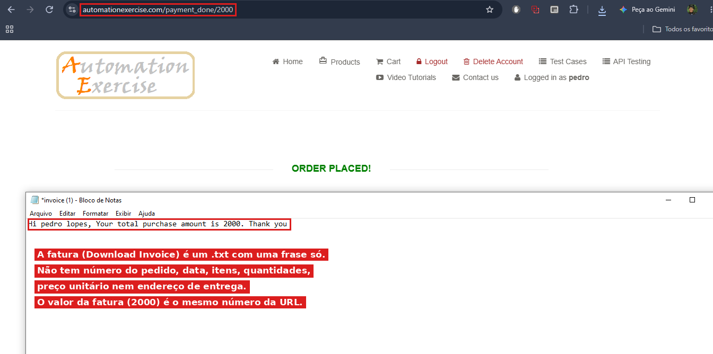

# OBS-010: Fatura é um .txt com uma frase

| Campo | Valor |
|---|---|
| Tipo | Regra que falta |
| Frente | Compra |
| Severidade | Média |
| Teste automatizado | `cypress/e2e/compra/compra-ponta-a-ponta.cy.js` confere o total da fatura |

## Passos para reproduzir
1. Concluir uma compra.
2. Clicar em Download Invoice.

## Resultado esperado
Comprovante com número do pedido, data, itens, quantidades, preços e endereço.

## Resultado obtido
Arquivo de texto com "Hi <nome>, Your total purchase amount is <valor>. Thank you". O valor é o mesmo número da URL `/payment_done/<valor>`.

## Impacto para o negócio
Cliente sem comprovante útil; conferência do pedido impossível. A relação do valor com a URL precisa ser investigada (risco de manipulação).

## Sugestão de correção
Gerar fatura completa a partir do pedido gravado, não de parâmetro de URL.

## Evidência

