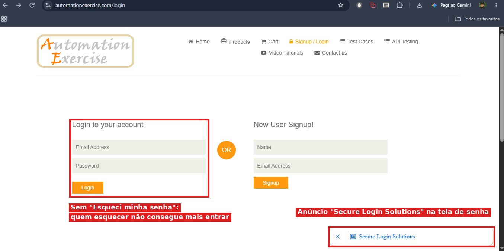
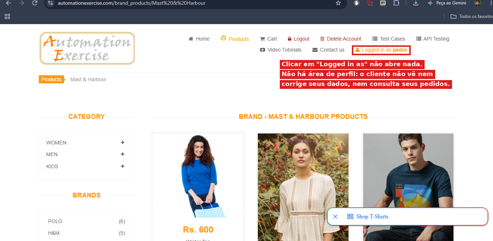

# OBS-011: Sem recuperação de senha e sem área do cliente

| Campo | Valor |
|---|---|
| Tipo | Regra que falta |
| Frente | API de conta / Compra |
| Severidade | Média |
| Teste automatizado | Manual |

## Passos para reproduzir
1. Abrir a tela de login e procurar "Esqueci minha senha".
2. Logado, clicar em "Logged in as <nome>".

## Resultado esperado
Recuperação de senha e área com dados cadastrais e histórico de pedidos (perguntas P05 e P09).

## Resultado obtido
Não há recuperação de senha. "Logged in as" não abre nada: não dá para ver nem corrigir dados nem consultar pedidos pela tela.

## Impacto para o negócio
Cliente que esquece a senha fica bloqueado. Dados errados só se corrigem pela API.

## Sugestão de correção
Incluir fluxo de recuperação por e-mail e área do cliente.

## Evidência

