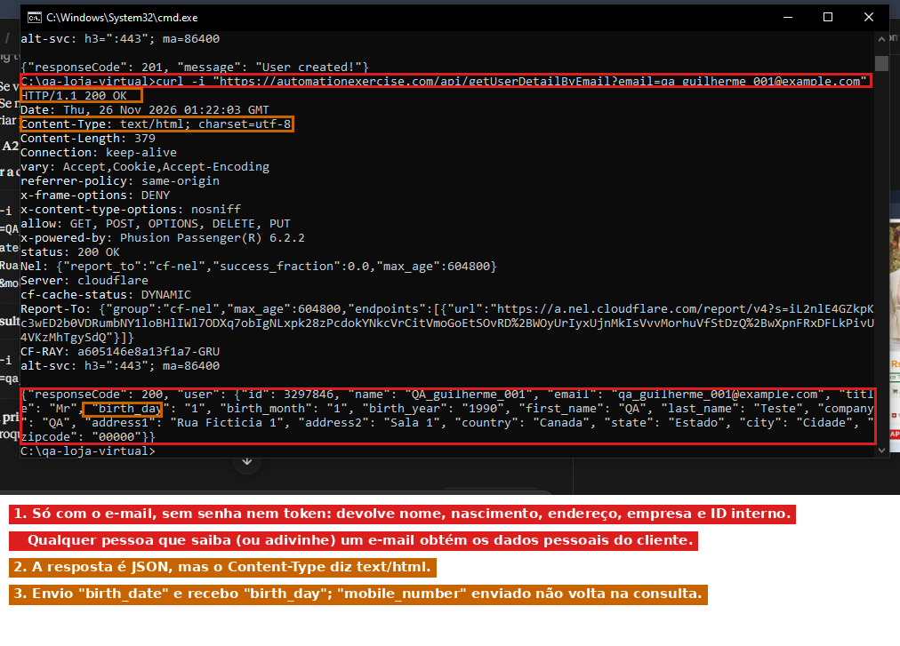

# OBS-012: Contrato da API inconsistente

| Campo | Valor |
|---|---|
| Tipo | Bug |
| Frente | API de conta |
| Severidade | Baixa |
| Teste automatizado | `cypress/e2e/api-conta/estrutura.cy.js` (falha esperada) |

## Passos para reproduzir
1. Criar conta pela API com `birth_date` e `mobile_number`.
2. Consultar com `getUserDetailByEmail` e ver os cabeçalhos.

## Resultado esperado
Content-Type `application/json`; os campos voltam com o mesmo nome em que foram enviados.

## Resultado obtido
Content-Type `text/html`. `birth_date` volta como `birth_day`, e `mobile_number` não volta.

## Impacto para o negócio
Integrações precisam de tratamento manual; dado cadastrado parece perdido.

## Sugestão de correção
Padronizar o Content-Type e os nomes de campos entre envio e consulta.

## Evidência

