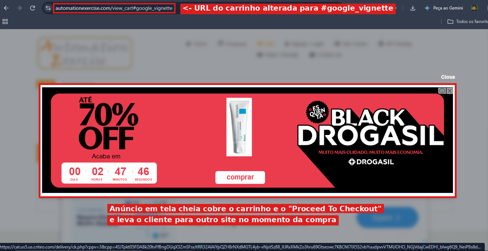
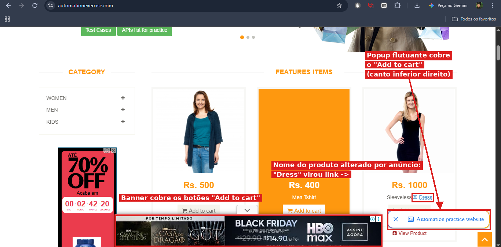
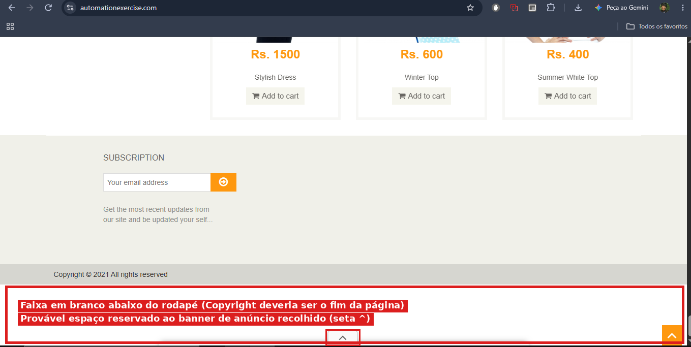

# OBS-013: Anúncios de terceiros interferem no carrinho e no catálogo

| Campo | Valor |
|---|---|
| Tipo | Risco |
| Frente | Carrinho / Catálogo |
| Severidade | Média |
| Teste automatizado | Não se aplica: a automação bloqueia anúncios (ver DECISOES.md) |

## Passos para reproduzir
1. Navegar sem bloqueador de anúncio pela lista de produtos e pelo carrinho.

## Resultado esperado
Nenhum conteúdo de terceiros cobrindo ações de compra ou alterando nomes de produtos (pergunta P03).

## Resultado obtido
Anúncio em tela cheia cobre o carrinho e muda a URL (#google_vignette); banners cobrem "Add to cart"; scripts transformam partes do nome do produto em links; faixa em branco no rodapé.

## Impacto para o negócio
Cliente levado para outro site no momento da compra; nome do produto alterado na tela.

## Sugestão de correção
Remover anúncios do módulo entregue ao CPB ou restringi-los a áreas sem ações de compra.

## Evidência

