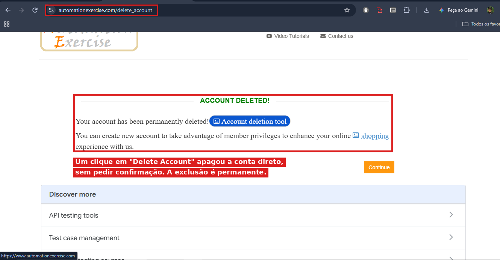

# OBS-014: Conta é apagada com um clique, sem confirmação

| Campo | Valor |
|---|---|
| Tipo | Melhoria |
| Frente | API de conta |
| Severidade | Média |
| Teste automatizado | Manual |

## Passos para reproduzir
1. Entrar com uma conta.
2. Clicar em Delete Account.

## Resultado esperado
Pedir confirmação (ou senha) antes de apagar (pergunta P07).

## Resultado obtido
A conta é apagada na hora e a tela informa exclusão permanente.

## Impacto para o negócio
Clique acidental faz o cliente perder a conta.

## Sugestão de correção
Adicionar confirmação com digitação da senha.

## Evidência

