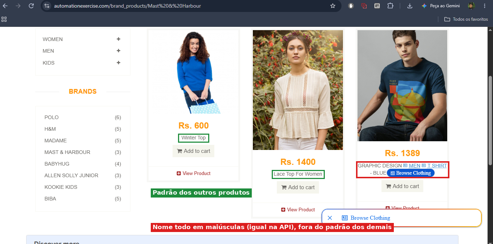

# OBS-015: Nomes de produtos sem padrão

| Campo | Valor |
|---|---|
| Tipo | Melhoria |
| Frente | Catálogo |
| Severidade | Baixa |
| Teste automatizado | Coberto indiretamente por `cypress/e2e/catalogo/busca-tela-x-api.cy.js` (termos "tshirt" e "t-shirt") |

## Passos para reproduzir
1. Comparar os nomes dos 34 produtos na tela e na API.

## Resultado esperado
Mesmo padrão de escrita em todos os nomes.

## Resultado obtido
Um nome todo em maiúsculas; "T-shirt" escrito de 4 jeitos (Tshirt, T-Shirt, T-Shirts, T SHIRT); traço longo e espaço faltando em alguns nomes.

## Impacto para o negócio
Busca por "tshirt" pode não encontrar "T-Shirt"; catálogo com aparência descuidada.

## Sugestão de correção
Padronizar o cadastro e normalizar a busca (ignorar hífen e espaço).

## Evidência

