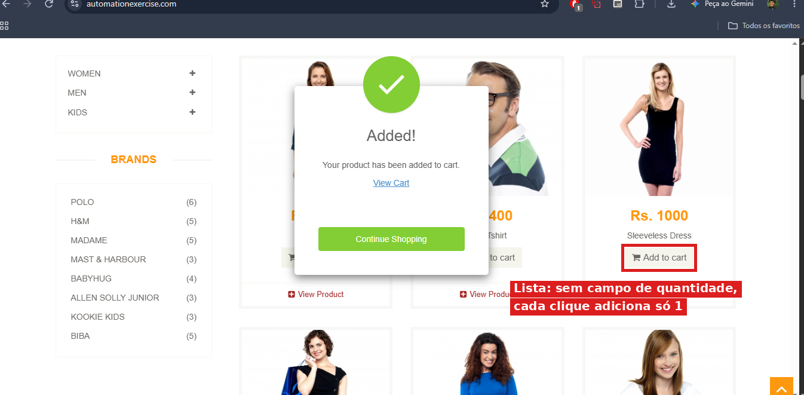
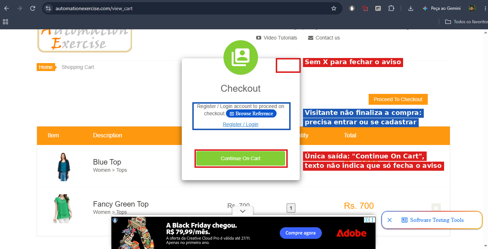

# OBS-016: Usabilidade: lista sem quantidade e aviso de checkout sem X

| Campo | Valor |
|---|---|
| Tipo | Melhoria |
| Frente | Carrinho |
| Severidade | Baixa |
| Teste automatizado | Manual |

## Passos para reproduzir
1. Na lista de produtos, usar "Add to cart".
2. Como visitante, clicar em Proceed To Checkout.

## Resultado esperado
Mesma possibilidade de escolher quantidade em todos os pontos; avisos fecham por X, Esc ou clique fora.

## Resultado obtido
A lista sempre adiciona 1 unidade. O aviso de login só fecha por "Continue On Cart", cujo texto não indica que só fecha o aviso.

## Impacto para o negócio
Mais cliques e confusão no momento de finalizar a compra.

## Sugestão de correção
Seletor de quantidade na lista (ou confirmar que é intencional, pergunta P01) e botão X no aviso.

## Evidência

