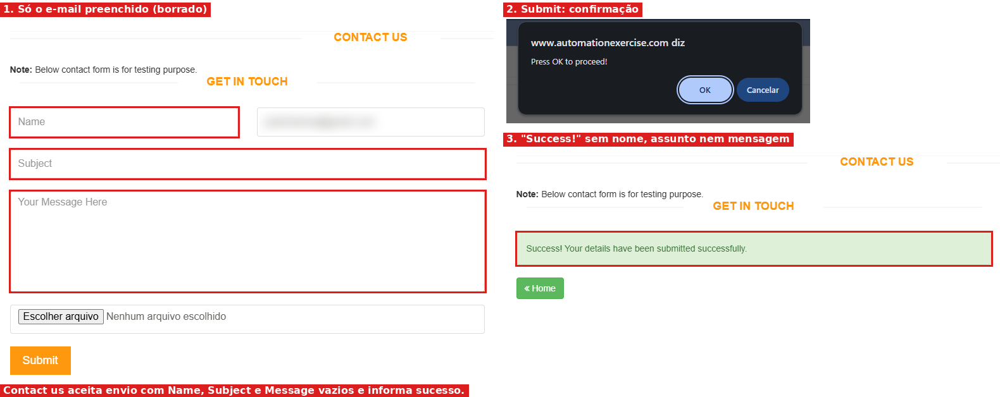
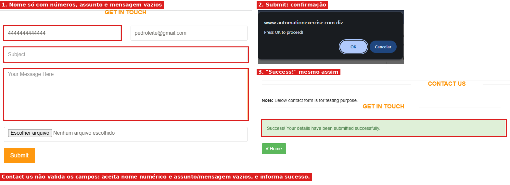

# OBS-017: Contact us não valida os campos

| Campo | Valor |
|---|---|
| Tipo | Bug |
| Frente | Geral |
| Severidade | Baixa |
| Teste automatizado | Manual |

## Passos para reproduzir
1. Abrir Contact us.
2. Preencher só o e-mail (ou nome com números) e enviar.

## Resultado esperado
Nome, assunto e mensagem obrigatórios, nome sem só números.

## Resultado obtido
Envio aceito com "Success!".

## Impacto para o negócio
Mensagens vazias chegam ao atendimento.

## Sugestão de correção
Validar os campos na tela e no servidor.

## Evidência

