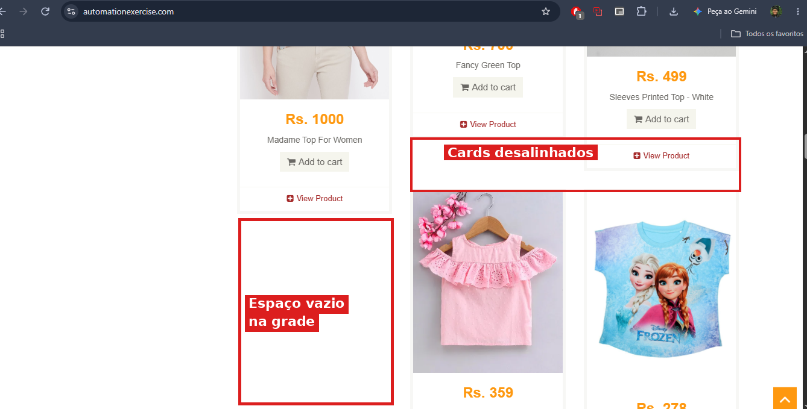

# OBS-018: Grade de produtos com buracos

| Campo | Valor |
|---|---|
| Tipo | Bug |
| Frente | Catálogo |
| Severidade | Baixa |
| Teste automatizado | Manual |

## Passos para reproduzir
1. Rolar a lista de produtos.

## Resultado esperado
Cards alinhados em linhas.

## Resultado obtido
Cards com alturas diferentes deixam espaços vazios na grade.

## Impacto para o negócio
Só visual.

## Sugestão de correção
Altura fixa nos cards ou layout em grid.

## Evidência

